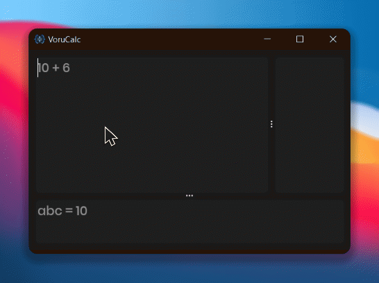

# VoruCalc

<p align="center">
	
</p>

<p align="center">
	<a href="https://github.com/undervolta/vorucalc/releases"><picture><source media="(prefers-color-scheme: dark)" srcset="https://shieldcn.dev/github/undervolta/vorucalc/release.svg?theme=zinc&amp;split=true&amp;mode=dark"></picture></a>
	<!-- <a href="https://">
		<picture><source media="(prefers-color-scheme: dark)" srcset="https://shieldcn.dev/badge/Documentation.svg?theme=slate&amp;logo=ri%3APiBookFill&amp;mode=dark"></picture>
	</a> -->
	<a href="https://github.com/undervolta/vorucalc"><picture><source media="(prefers-color-scheme: dark)" srcset="https://shieldcn.dev/github/undervolta/vorucalc/license.svg?theme=cyan&amp;split=true&amp;mode=dark"></picture></a>
	<a href="https://github.com/undervolta/vorucalc/releases"><picture><source media="(prefers-color-scheme: dark)" srcset="https://shieldcn.dev/github/undervolta/vorucalc/downloads.svg?theme=violet&amp;split=true&amp;mode=dark"></picture></a>
	<!-- <br>
	<a href="https://github.com/undervolta/vorucalc/releases">
		<picture><source media="(prefers-color-scheme: dark)" srcset="https://shieldcn.dev/badge/Download.svg?theme=blue&amp;logo=ri%3AFaWindows&amp;mode=dark"></picture>
	</a> -->
	<!-- <a href="https://github.com/undervolta/vorucalc/releases">
		<picture><source media="(prefers-color-scheme: dark)" srcset="https://shieldcn.dev/badge/Download.svg?theme=amber&amp;logo=linux&amp;mode=dark"></picture>
	</a> -->
</p>

VoruCalc is a notepad-style calculator. Type one expression per line and the result appears next to it. You can define variables and use them in your calculations.

<p align="center">
	
</p>

## Features

- **Line-by-line calculation:** each line is its own expression, and results are shown in the same order.
- **Variables:** define values like `x = 5; y = x * 2` and use them anywhere.
- **Built-in constants:** `pi`, `tau`, `phi`, `e`, `sqrt_2`, `ln2`, `ln10` and more.
- **Math functions:** trigonometry, logarithms, rounding, `min`/`max`, `pow` and others.
- **Method-style calls:** write `(-4).abs` or `2.pow(3)` as an alternative to `abs(-4)` and `pow(2, 3)`. You can also chain method calls like `(-4).abs.pow(2)`.
- **Helpful error messages:** points to the line with a syntax error or an unknown variable.
- **Customizable output:** decimal precision, decimal separator and digit separator.
- **Light and dark themes.**
- **Built-in help window** with an operator, function and shortcut reference.
- **Settings persistence:** your settings are saved to a `settings.toml` file in the app config directory.

## Getting Started

### Prerequisites

- [Rust](https://www.rust-lang.org/learn/get-started) (edition 2024, so a recent stable toolchain) with `cargo`.

### Build and Run

```sh
git clone https://github.com/undervolta/vorucalc.git
cd vorucalc
cargo run
```

To only build the binary:

```sh
cargo build --release
```

## Usage

The app has three tabs:

| Tab       | Purpose                                         |
| --------- | ----------------------------------------------- |
| Calculate | Write expressions, one per line                 |
| Variables | Define variables as `name = expression`         |
| Notes     | Free-form notes (can be hidden in the settings) |

### Example

Variables tab:

```
radius = 5
```

Calculate tab:

```
2 + 2
radius ^ 2 * pi
#16
max(radius, 8)
(-4).abs
```

### Operators

| Operator      | Description                | Example           |
| ------------- | -------------------------- | ----------------- |
| `+`           | Addition                   | `2 + 2` -> `4`    |
| `-`           | Subtraction / negation     | `5 - 3` -> `2`    |
| `*`           | Multiplication             | `3 * 4` -> `12`   |
| `/`           | Division                   | `7 / 2` -> `3.5`  |
| `//` or `\`   | Integer (floor) division   | `7 // 2` -> `3`   |
| `%`           | Modulo                     | `7 % 3` -> `1`    |
| `^` or `**`   | Exponent                   | `2 ^ 10` -> `1024` |
| `#`           | Square root (prefix)       | `#16` -> `4`      |
| `( )`         | Grouping                   | `(1 + 2) * 3` -> `9` |

Underscores can be used as digit separators in numbers, e.g. `1_000_000`.

### Functions

| Category      | Functions                                                            |
| ------------- | -------------------------------------------------------------------- |
| General       | `abs`, `sqrt`, `cbrt`, `pow`, `exp`, `exp2`, `ln`, `log`, `log10`, `log2`, `max`, `min`, `sign` |
| Rounding      | `ceil`, `floor`, `round`, `trunc`, `fract`                           |
| Trigonometry  | `sin`, `cos`, `tan`, `asin`, `acos`, `atan`, `atan2`, `sinh`, `cosh`, `tanh`, `asinh`, `acosh`, `atanh`, `deg`, `rad` |

The full reference is available in the app's help window (`F1`).

## Keyboard Shortcuts

| Shortcut     | Action             |
| ------------ | ------------------ |
| `Ctrl + 1`   | Switch to Tab 1    |
| `Ctrl + 2`   | Switch to Tab 2    |
| `Ctrl + 3`   | Switch to Tab 3    |
| `Ctrl + ,`   | Open Settings      |
| `F1`         | Open Help Window   |
| `F10`        | Toggle Menu        |
| `F11`        | Toggle Fullscreen  |

## Settings

Open the settings with `Ctrl + ,`. Available options:

- Dark mode
- Show error messages
- Show notes
- Separate variables
- Save on close
- Decimal precision
- Decimal separator
- Digit separator
- Font size

## Project Structure

```
vorucalc/
├── src/
│   ├── main.rs         # App entry point and callbacks
│   ├── lang/           # Lexer, parser and evaluator (logos + chumsky)
│   ├── components/     # Tabs and help content
│   ├── stores/         # App state and settings storage
│   └── utils/
├── ui/                 # Slint UI files (window, components, styles, stores)
├── build.rs            # Slint build script
└── Cargo.toml
```

## Built with

- [Rust](https://www.rust-lang.org/)
- [Slint](https://slint.rs/): UI toolkit
- [logos](https://github.com/maciejhirsz/logos): lexer
- [chumsky](https://github.com/zesterer/chumsky): parser combinators
- [serde](https://serde.rs/) and [toml](https://github.com/toml-rs/toml): settings serialization

## License

Distributed under the MIT License. See [LICENSE](https://github.com/undervolta/vorucalc/blob/main/LICENSE) for details.
